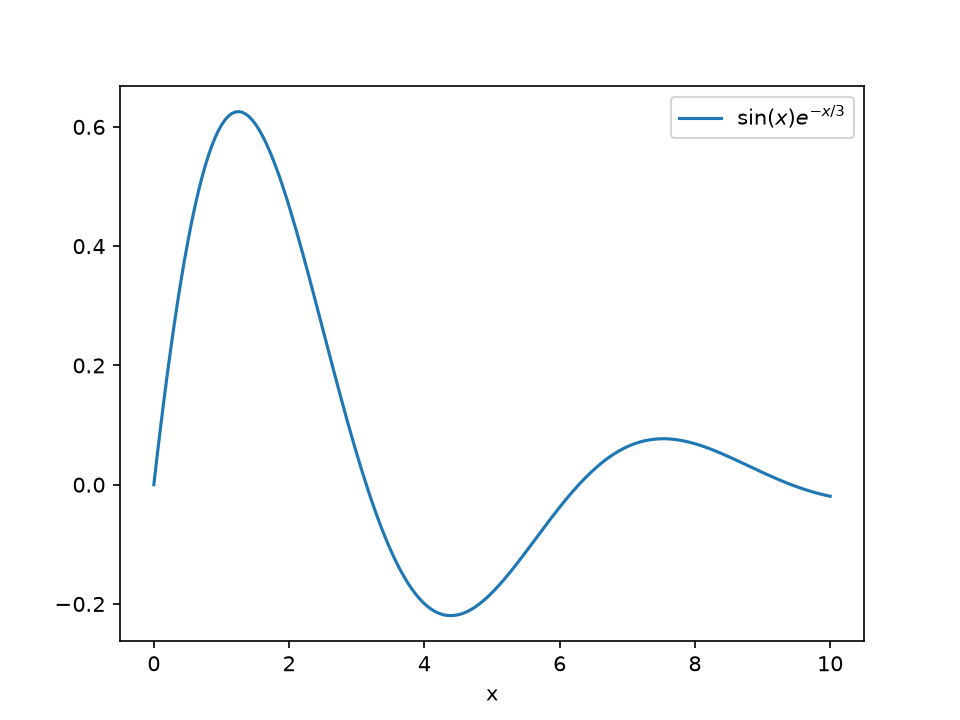

# Stress-тест научного контента

CONTROL_STRING_SSG_LAB

Демонстрационная страница сравнивает возможности генераторов статических сайтов
на одном и том же наборе элементов: формулы, таблицы, графики, код, библиография.

## Метод

Все измерения (время сборки, вес страницы) приведены в разделе [Результаты](#results).
Сначала формализуем задачу регрессии (см. уравнение [1](#eq-mse)).

## Модель и формулы

Нумерованная формула со ссылкой из текста — среднеквадратичная ошибка (eq. [1](#eq-mse)):

<div id="eq-mse" markdown>

$$
\mathrm{MSE} = \frac{1}{n}\sum_{i=1}^{n}\left( y_i - \hat{y}_i \right)^2 \tag{1}
$$

</div>

и её регуляризованный вариант с весами из amsmath-окружения `aligned` (eq. [2](#eq-reg)):

<div id="eq-reg" markdown>

$$
\begin{aligned}
\mathcal{L}(\theta) &= \underbrace{\frac{1}{n}\sum_{i=1}^{n}\left( y_i - f_\theta(x_i) \right)^2}_{\text{данные}}
+ \lambda\,\underbrace{\lVert\theta\rVert_2^2}_{\text{регуляризатор}}
\end{aligned} \tag{2}
$$

</div>

> **Замечание (MkDocs).** Автонумерация `\tag{}` здесь проставляется вручную:
> у Material нет нативной нумерации уравнений (в отличие от Sphinx/MyST и Quarto) —
> это зафиксировано в отчёте как ограничение генератора.

## Таблица с объединёнными ячейками

<table>
<caption>Таблица 1 — Сравнение времени обучения по датасетам</caption>
<thead>
<tr><th rowspan="2">Модель</th><th colspan="2">Датасет A</th><th colspan="2">Датасет B</th></tr>
<tr><th>CPU, c</th><th>GPU, c</th><th>CPU, c</th><th>GPU, c</th></tr>
</thead>
<tbody>
<tr><td>Линейная</td><td>1.2</td><td>0.8</td><td>3.1</td><td>1.9</td></tr>
<tr><td>MLP</td><td>4.5</td><td>1.1</td><td>9.7</td><td>2.4</td></tr>
<tr><td colspan="5" style="text-align:center">CPU: 8-ядерный Xeon; GPU: RTX-class</td></tr>
</tbody>
</table>

## Результаты {#results}

<div class="grid" markdown>

<div markdown>

Текстовая колонка: график справа — статический (matplotlib), ниже — интерактивный (Plotly).
Обе реализации собраны пайплайном, графики не тянут внешних CDN. См. также
[@doe2023] и сравнение с базовым подходом [@smith2021].

</div>

<div markdown>

{ width="300" }

</div>

</div>

Статический график: `docs/img/fig_static.png` (matplotlib, 150 dpi, ~35 КБ).
Интерактивный график (Plotly):

--8<-- "include/fig_plotly.html"

Код, которым построены графики:

```python
import matplotlib.pyplot as plt
import numpy as np

x = np.linspace(0, 10, 200)          # сетка
y = np.sin(x) * np.exp(-x / 3)        # затухающая синусоида
plt.plot(x, y, label=r"$\sin(x)e^{-x/3}$")
plt.xlabel("x"); plt.legend(); plt.savefig("docs/img/fig_static.png", dpi=150)
```

```python
# Интерактивный график (Plotly) — fig.write_html("docs/include/fig_plotly.html",
# full_html=False) и подключение через --8<-- "include/fig_plotly.html"
import plotly.graph_objects as go
fig = go.Figure(go.Scatter(x=x, y=y, mode="lines+markers", name="signal"))
fig.write_html("docs/include/fig_plotly.html", full_html=False)
```

## Сборка из CSV на этапе сборки

{{ read_csv("docs/tables/scores.csv") }}

## Код эксперимента (листинг с номерами строк)

```python linenums="1"
def train(model, loader, epochs: int = 20) -> float:   # (1) обучение
    best = float("inf")
    for epoch in range(epochs):                          # (2) цикл по эпохам
        loss = model.fit_epoch(loader)                   # (3) одна эпоха
        best = min(best, loss)                           # (4) трекинг минимума
    return best
```

## Заключение

Страница содержит сноску[^note], перекрёстную ссылку на раздел [Метод](#метод)
и автоматический список литературы ниже. CONTROL_STRING_SSG_LAB

[^note]: Сноски — нативная возможность Markdown-расширения `footnotes`.

## Список литературы

\bibliography
